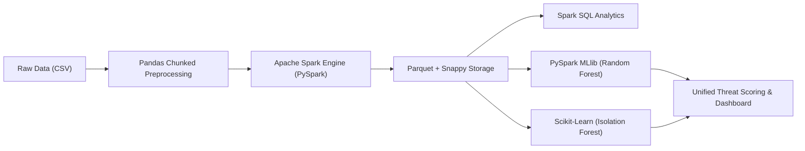

# Comprehensive Technical Master Guide: Big Data Cybersecurity Log Analytics & Threat Detection

A complete, exhaustive reference manual explaining the architecture, execution pipeline, Big Data / Hadoop concepts behind the outputs (e.g. `part-00000`, `_SUCCESS`), Machine Learning models, and exact step-by-step commands to run every phase.

---

## 📑 Table of Contents
1. [Project Overview & Core Mission](#1-project-overview--core-mission)
2. [Why Big Data & Hadoop Concepts? (Explaining `part-00000`, `_SUCCESS`, and CRC files)](#2-why-big-data--hadoop-concepts-explaining-part-00000-_success-and-crc-files)
3. [Technology Stack & Role Mapping](#3-technology-stack--role-mapping)
4. [Step-by-Step Execution Lifecycle & Commands](#4-step-by-step-execution-lifecycle--commands)
5. [In-Depth Machine Learning Deep Dive](#5-in-depth-machine-learning-deep-dive)
6. [Understanding the Project Outputs & Folder Structure](#6-understanding-the-project-outputs--folder-structure)
7. [Comprehensive Viva, Oral Exam & Interview Master Q&A](#7-comprehensive-viva-oral-exam--interview-master-qa)

---

## 1. Project Overview & Core Mission

### 🎯 What is this project?
This project is an **End-to-End Enterprise Big Data & Machine Learning Framework** engineered for distributed processing, SQL aggregation, and real-time threat classification over massive cybersecurity network connection logs. It leverages the **CICIDS2017** benchmark dataset consisting of **2,522,362 network flow records** across 8 full business days of traffic.

### 🛡️ Why is it needed?
1. **Massive Log Explosion:** Modern firewalls, routers, and honeypots generate hundreds of millions of packet logs daily. Single-node tools like Python Pandas or traditional relational databases (MySQL/PostgreSQL) run out of memory (OOM crashes) or take hours to complete simple queries.
2. **Defeating Modern Threats:**
   - **Known Signature Attacks:** Handled via supervised distributed learning (**Random Forest**).
   - **Novel Zero-Day Anomalies:** Handled via unsupervised isolation trees (**Isolation Forest**) which do not require prior labeled attack signatures.
3. **Automated SOC Triage:** Correlates predictions into risk-weighted threat tiers (`CRITICAL`, `HIGH`, `MEDIUM`, `LOW`, `INFORMATIONAL`) so Security Operations Center (SOC) engineers can prioritize containment within milliseconds.

---

## 2. Why Big Data & Hadoop Concepts? (Explaining `part-00000`, `_SUCCESS`, and CRC files)

When inspecting the `results/` folder, you see files such as:
```
results/analytics/attack_distribution/
├── ._SUCCESS.crc
├── .part-00000-f7fd1ca6-5abd-47b6-a055-dfeccb163d04-c000.csv.crc
├── _SUCCESS
└── part-00000-f7fd1ca6-5abd-47b6-a055-dfeccb163d04-c000.csv
```

### ❓ Why do these files appear?
Even though the script was run using PySpark, **Apache Spark is built directly upon the Apache Hadoop ecosystem (Hadoop FileSystem API / MapReduce paradigms)**.

### 🔍 Anatomy of Distributed Output Files:

| File Name | Hadoop / Spark Mechanism | What It Means in This Project |
| :--- | :--- | :--- |
| **`part-00000-...`** | **Distributed Partition Shard** | In distributed computing (Hadoop MapReduce / Spark), a dataset is split into parallel chunks called **partitions**. Each worker core writes out its slice independently. `part-00000` is the output partition written by Worker Task #0. If you had 8 parallel write tasks, you would see `part-00000` through `part-00007`. |
| **`_SUCCESS`** | **Commit Marker / Output Committer** | In distributed systems, if a cluster crashes halfway through writing, you don't want half-written corrupt data. Spark uses the Hadoop `FileOutputCommitter`. Only when **every worker completes successfully with zero errors** does the driver write this empty `_SUCCESS` marker file. Downstream jobs check for `_SUCCESS` before ingesting data. |
| **`.*.crc`** | **Cyclic Redundancy Check (Checksum)** | A mathematical hash generated by Hadoop's filesystem layer (`RawLocalFileSystem`). It verifies data integrity across disk transfers. If a bit flips due to hardware faults, the checksum check fails and flags corruption. |
| **Snappy Compression (`.snappy.parquet`)** | **Hadoop Block Compression** | Snappy is Google's high-speed compression algorithm standard in Hadoop and Spark. It enables CPU-efficient compression without significant decompression overhead during analytical scans. |

---

## 3. Technology Stack & Role Mapping



| Technology | Layer | Primary Responsibility |
| :--- | :--- | :--- |
| **Apache Spark (PySpark 3.5+)** | Distributed Compute Engine | Executes parallelized ETL, in-memory RDD/DataFrame caching, schema enforcement, distributed aggregations, and horizontal scaling. |
| **Hadoop FileSystem (HDFS Layer)** | Distributed Storage Interface | Implements partitioning, `FileOutputCommitter` two-phase commit protocol (`_SUCCESS`), and block-level checksum validation. |
| **Apache Parquet** | Columnar File Format | Stores 2.52M flow logs column-by-column rather than row-by-row. Enables **column pruning** (loading only features requested) and **predicate pushdown** (skipping unneeded row groups). |
| **PySpark MLlib** | Distributed Machine Learning | Orchestrates distributed machine learning: `StringIndexer` (label encoding), `VectorAssembler` (combining 78 numeric flow features into sparse vectors), and `RandomForestClassifier`. |
| **Scikit-Learn** | Unsupervised Anomaly Modeling | Trains `IsolationForest` on clean baseline traffic to detect anomalies and compute continuous outlier scores. |
| **Python (Pandas, NumPy, Joblib)** | Ingestion & Serialization | Chunked raw CSV cleansing (`chunksize=100,000`), infinity handling (`np.inf` to `NaN`), and binary model persistence. |
| **HTML5, Tailwind CSS, Chart.js** | Front-End Presentation | Live SOC interactive dashboard (`dashboard.html`) displaying dynamic graphs, KPI counters, and real-time incident triage logs. |

---

## 4. Step-by-Step Execution Lifecycle & Commands

Here are the exact commands to execute each phase of the project:

### Phase 1: Environment Setup
```bash
# Clone the repository
git clone https://github.com/abhiram274/cybersecurity-threat-analytics.git
cd cybersecurity-threat-analytics

# Create and activate virtual environment
python -m venv venv
.\venv\Scripts\activate      # On Windows
source venv/bin/activate     # On Linux / macOS

# Install all project dependencies
pip install -r requirements.txt
```

---

### Phase 2: Dataset Extraction
The dataset is `MachineLearningCSV.zip` (CICIDS2017).
```bash
# Unpack the 8 daily PCAP flow CSVs into data/
python -c "import zipfile; zipfile.ZipFile('MachineLearningCSV.zip').extractall('data')"
```

---

### Phase 3: Stage-by-Stage Script Execution

#### Step 1: Dataset Exploration & Profiling
```bash
python src/01_dataset_exploration.py
```
- **What it does:** Scans the 8 daily network log files, cleans leading/trailing whitespace in header columns, verifies row counts, and prints schema types.

#### Step 2: Chunked Preprocessing & Sanitization
```bash
python src/02_data_preprocessing.py
```
- **What it does:** Reads multi-gigabyte raw CSV files in manageable chunks of **100,000 rows** to avoid RAM bottlenecks.
- Replaces mathematical infinities (`inf`, `-inf`) resulting from zero-duration flow division.
- Replaces missing numerical values with `0`.
- Writes sanitized files to `results/cleaned_data/`.

#### Step 3: Distributed Spark Processing & Parquet Conversion
```bash
python src/03_spark_processing.py
```
- **What it does:** Boots a Spark Session configured with `local[2]` and 8 shuffle partitions.
- Deduplicates 2.52M log records.
- Converts the row-oriented CSVs into compressed, partitioned **Apache Parquet** columnar files saved in `results/parquet/`.

#### Step 4: Distributed Spark SQL Analytics
```bash
python src/04_spark_sql_analytics.py
```
- **What it does:** Creates distributed Spark SQL views: `cybersecurity_logs` and `security_events`.
- Executes distributed SQL queries:
  1. Attack category distribution.
  2. Top 10 malicious attack ranking.
  3. Traffic breakdown (`NORMAL` vs `MALICIOUS`).
  4. Descriptive flow statistics (packet means, duration min/max).
- Writes distributed results to `results/analytics/` (generating the Hadoop `part-00000` and `_SUCCESS` files).

#### Step 5: Supervised Threat Classification (Random Forest)
```bash
python src/05_threat_classification.py
```
- **What it does:** Selects 78 numeric network features.
- Converts target labels into indices using `StringIndexer`.
- Assembles feature vectors using `VectorAssembler`.
- Trains a distributed **Random Forest Classifier** (30 trees, depth 10) on 2,018,252 records and evaluates on 504,110 test records.
- Generates `models/random_forest/`, `models/label_mapping.json`, and `results/ml/classification_metrics.json`.

#### Step 6: Unsupervised Anomaly Detection (Isolation Forest)
```bash
python src/06_anomaly_detection.py
```
- **What it does:** Filters out known malicious events from 150,000 samples to establish a pure **Benign Baseline (124,512 flows)**.
- Trains an `IsolationForest` model to detect structural deviations.
- Identifies **12,064 anomalous outliers** and exports them with anomaly scores to `results/anomalies/detected_anomalies.csv.gz`.

#### Step 7: Unified Threat Detection & Severity Scoring Engine
```bash
python src/07_unified_threat_detection.py
```
- **What it does:** Loads model metadata and correlates supervised predictions with unsupervised anomaly scores.
- Dynamically assigns severity ratings (`CRITICAL`, `HIGH`, `MEDIUM`, `LOW`, `INFORMATIONAL`) and outputs live stream threat triage logs.

#### Step 8: Launch the Interactive SOC Dashboard
```powershell
# Open the interactive HTML5 SOC dashboard in your default browser
Start-Process dashboard.html
```

---

## 5. In-Depth Machine Learning Deep Dive

```
+-----------------------------------------------------------------------------------+
|                           DUAL-LAYERED THREAT DETECTION                           |
+-----------------------------------------+-----------------------------------------+
|      LAYER 1: SUPERVISED LEARNING       |      LAYER 2: UNSUPERVISED LEARNING     |
|         (Random Forest Classifier)      |             (Isolation Forest)          |
+-----------------------------------------+-----------------------------------------+
| • Identifies 15 known attack signatures | • Detects unknown zero-day anomalies   |
| • Trained on 2,018,252 labeled flows    | • Trained on 124,512 benign baselines   |
| • 99.55% Accuracy / 99.46% F1-Score     | • 79.35% Precision on Outlier Detection |
+-----------------------------------------+-----------------------------------------+
```

### 🌲 Model 1: Random Forest Classifier (Supervised ML)
* **Framework:** PySpark MLlib (`pyspark.ml.classification.RandomForestClassifier`)
* **Role in Project:** Primary defense against documented cyberattacks. It categorizes every packet into one of 15 classes (DoS Hulk, DDoS, PortScan, FTP-Patator, SSH-Patator, Botnet, Web Attacks, etc.).
* **Technical Parameters:**
  - `numTrees = 30`: Generates an ensemble of 30 randomized decision trees.
  - `maxDepth = 10`: Limits tree depth to prevent overfitting on noisy network packet timestamps.
  - `featuresCol = "features"`: 78 continuous numerical flow metrics assembled via `VectorAssembler`.
  - `splitCriterion = "gini"`: Measures node impurity before splitting.
* **Why it fits Big Data cybersecurity:**
  - **Overfitting Resistance:** Bagging (bootstrap aggregation) averages predictions from 30 independent trees.
  - **Handles High Feature Dimensionality:** Evaluates all 78 flow features without requiring PCA dimension reduction.
  - **Horizontal Parallelism:** Spark builds individual decision trees in parallel across cluster executors.
* **Evaluation Metrics:**
  - **Accuracy:** `99.5489%`
  - **Weighted Precision:** `99.4618%`
  - **Weighted Recall:** `99.5489%`
  - **Weighted F1-Score:** `99.4640%`

---

### 🌲 Model 2: Isolation Forest (Unsupervised Anomaly Detection)
* **Framework:** Scikit-Learn (`sklearn.ensemble.IsolationForest`)
* **Role in Project:** Zero-Day threat hunter. Detects novel, previously unseen attacks where no historical signature exists.
* **Core Intuition:**
  - Traditional anomaly detection models normal density (e.g., Gaussian mixtures) and flags points in sparse regions.
  - **Isolation Forest isolates anomalies directly:** Because anomalies have atypical feature values (e.g., an abnormal ratio of forward-to-backward packets or extreme inter-arrival times), they require significantly fewer random splits to isolate in a tree.
  - *Short path length $\to$ high anomaly probability $\to$ negative anomaly score.*
* **Training Methodology:**
  - Trained purely on **124,512 BENIGN network flows**. It learns what normal web, DNS, and file transfer traffic looks like.
  - Tested on 150,000 mixed flows. When attack traffic hits the model, it flags them as statistical outliers.
* **Evaluation Metrics:**
  - **Anomalies Flagged:** 12,064 records
  - **Precision:** `79.3518%` (nearly 8 out of every 10 flagged outliers were confirmed malicious attacks)
  - **Accuracy:** `87.7293%`

---

## 6. Understanding the Project Outputs & Folder Structure

```
Cybersecurity-Threat-Analytics/
├── dashboard.html                  # Interactive HTML5/Tailwind/Chart.js SOC dashboard
├── PROJECT_PREPARATION_GUIDE.md    # Quick viva & interview prep summary
├── COMPREHENSIVE_MASTER_GUIDE.md   # This detailed technical documentation
├── README.md                       # GitHub documentation & execution guide
├── requirements.txt                # Python package dependencies
├── .gitignore                      # Git exclusion rules (large archives & parquet excluded)
├── MachineLearningCSV.zip          # Raw CICIDS2017 multi-day dataset archive
├── data/                           # Extracted dataset directory
│   ├── .gitkeep
│   └── MachineLearningCVE/         # 8 daily raw network flow CSV files
├── models/                         # Model metadata & saved states
│   ├── feature_names.json          # List of 78 extracted numeric features
│   ├── label_mapping.json          # Dictionary mapping 15 attack class indices to names
│   ├── isolation_forest.joblib     # Serialized Scikit-Learn Isolation Forest binary
│   └── random_forest/              # Spark MLlib distributed Random Forest model stages
├── results/                        # Distributed computation outputs
│   ├── analytics/                  # Hadoop-partitioned Spark SQL aggregations
│   │   ├── attack_distribution/    # Events per attack category (part-00000 + _SUCCESS)
│   │   ├── top_attacks/            # Top 10 attacks ranked by count
│   │   ├── traffic_statistics/     # Mean, stddev, min, max of flow features
│   │   └── traffic_summary/        # NORMAL (2.09M) vs MALICIOUS (425K) totals
│   ├── anomalies/                  # Isolation Forest detection results
│   │   ├── anomaly_metrics.json    # Precision, recall, and detection counters
│   │   └── detected_anomalies.csv.gz # 12,064 flagged outlier flow records
│   ├── cleaned_data/               # Chunked cleaned CSV files
│   ├── ml/                         # Random Forest classification metrics
│   │   └── classification_metrics.json # 99.55% accuracy and F1 score
│   └── parquet/                    # Partitioned Spark columnar data (snappy compressed)
├── screenshots/                    # Real CLI executions, dashboards & visual charts
│   ├── 01_spark_sql_analytics_dashboard.png
│   ├── 02_ml_models_benchmark_results.png
│   ├── 03_unified_threat_pipeline_execution.png
│   ├── cli_execution_spark_sql_analytics.png
│   ├── cli_execution_unified_threat_detection.png
│   ├── visual_metric_attack_distribution.png
│   └── visual_metric_model_comparison.png
└── src/                            # Python execution scripts (01 through 07)
```

---

## 7. Comprehensive Viva, Oral Exam & Interview Master Q&A

### Q1: What makes this a "Big Data" project rather than a standard ML project?
> **Answer:** *"The dataset comprises 2,522,362 network flow records with 79 features across multiple days of PCAP captures. Standard data science stacks using Pandas load the entire file into single-machine RAM, leading to memory saturation or crashes during matrix multiplications. We implemented Apache Spark to distribute the workload across partitions, convert data into columnar Parquet files with Snappy compression, execute distributed Spark SQL queries, and train a distributed Random Forest using Spark MLlib."*

### Q2: Why are there `part-00000` and `_SUCCESS` files in our results folder?
> **Answer:** *"These files originate from the Apache Hadoop FileSystem standard utilized by Apache Spark. In distributed processing, outputs are written in parallel partitions by worker nodes; `part-00000` is the first partition written by Worker Task 0. The `_SUCCESS` file is an empty marker created by Hadoop's `FileOutputCommitter` to certify that all distributed tasks completed without failure. The associated `.*.crc` files contain Cyclic Redundancy Check checksums to detect disk corruption."*

### Q3: Why convert raw CSVs into Apache Parquet?
> **Answer:** *"CSV is a row-oriented, uncompressed text format where finding one column requires scanning the entire disk file. Parquet is a binary columnar format that provides two major Big Data benefits:
> 1. **Column Pruning:** If an analytic query or ML model only needs 5 features out of 78, Spark reads only those 5 columns from disk.
> 2. **Predicate Pushdown & Compression:** Using Snappy compression and min/max block metadata, Spark skips irrelevant data blocks completely, cutting disk I/O and boosting query speeds up to 10x."*

### Q4: Why did you use both Random Forest AND Isolation Forest?
> **Answer:** *"They address two distinct cybersecurity challenges:
> - **Random Forest (Supervised):** Has high accuracy (99.55%) on known attacks (e.g. DoS Hulk, DDoS, PortScan) by training on historical labeled flows. However, it cannot reliably classify an attack it has never seen before.
> - **Isolation Forest (Unsupervised):** Is trained exclusively on normal benign traffic. When a novel zero-day attack or stealth probe occurs, its atypical flow characteristics isolate it quickly in random partition trees, flagging it as an outlier with 79.35% precision without needing a pre-existing label."*

### Q5: How did you handle infinite values (`inf`, `-inf`) during data preprocessing?
> **Answer:** *"In network flow logs, features like `Flow Bytes/s` or `Flow Packets/s` are calculated by dividing packet volume by flow duration. When a flow duration is 0 microseconds, division by zero occurs, producing `+inf` or `-inf`. In `02_data_preprocessing.py`, we used NumPy's `chunk.replace([np.inf, -np.inf], np.nan)` in 100,000-row chunks, followed by imputation with 0 to prevent downstream gradient or decision-tree math errors."*

### Q6: How does the Unified Threat Engine assign Severity Tiers?
> **Answer:** *"In `07_unified_threat_detection.py`, we correlate the multi-class prediction with the anomaly score. High-impact availability-destroying attacks (`DDoS`, `DoS Hulk`, `Heartbleed`, `Infiltration`) are automatically assigned `CRITICAL`. High-risk probing and application-exhaustion attacks (`DoS GoldenEye`, `Botnets`, `Slowloris`) are tagged `HIGH`. Credential-stuffing attacks (`FTP-Patator`, `SSH-Patator`) are tagged `MEDIUM`. Verified normal baseline traffic is tagged `INFORMATIONAL`."*
