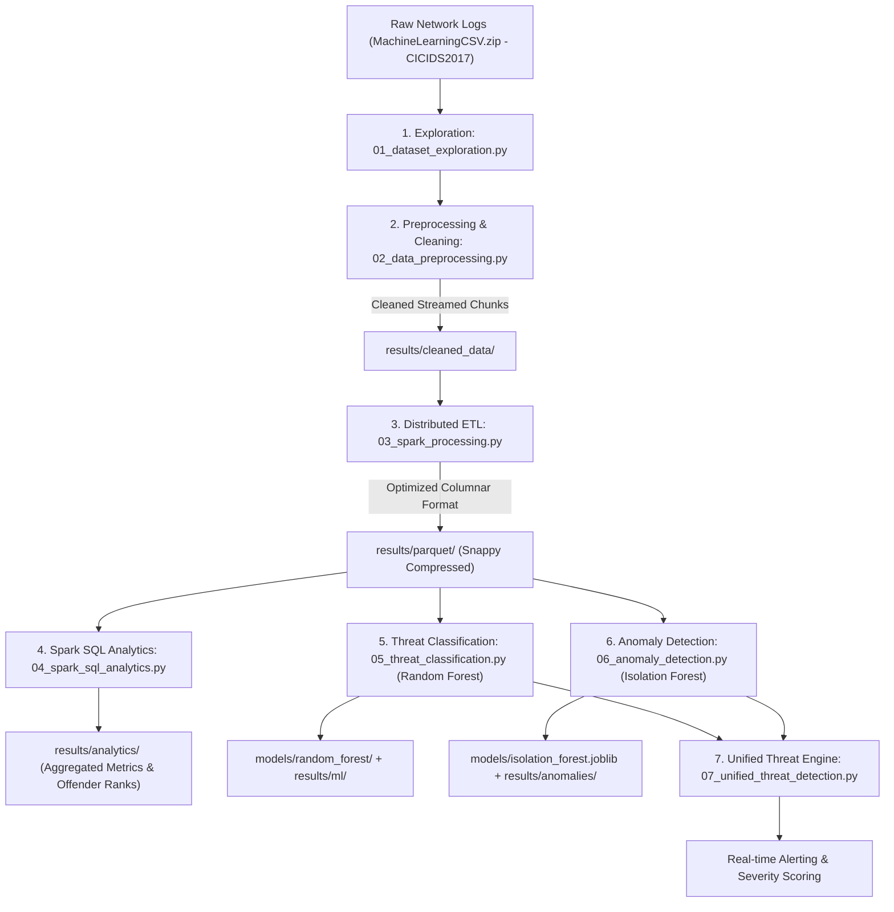

# Project Preparation Guide: Cybersecurity Log Analytics and Threat Classification

A comprehensive viva, interview, and technical preparation document covering the project background, real-world utility, architecture, tech stack breakdown, and in-depth details of the Machine Learning models used.

---

## 1. Executive Summary & Project Purpose

### What is this project?
This project is an **Enterprise-Scale Big Data & Machine Learning Framework** built to ingest, sanitize, analyze, and detect security threats from millions of network flow event logs (specifically utilizing the Canadian Institute for Cybersecurity **CICIDS2017** benchmark dataset).

### What problem does it solve?
In modern enterprise environments, networks generate gigabytes or terabytes of connection logs every hour:
1. **Volume and Velocity:** Traditional relational databases (MySQL, PostgreSQL) crash or crawl under millions of log rows.
2. **Evolving Attack Vectors:** Signature-based firewalls (like traditional antivirus or simple rules) only catch previously documented threats and miss novel zero-day attacks or stealthy low-and-slow DoS attacks.
3. **Alert Fatigue:** SOC (Security Operations Center) analysts are flooded with false alarms.

### What is the use / business value of this project?
- **Automated SOC Triage:** Automatically correlates and prioritizes network threats into clear severity levels (`CRITICAL`, `HIGH`, `MEDIUM`, `LOW`, `INFORMATIONAL`).
- **Distributed Big Data Querying:** Aggregates and runs analytical queries across 2.5+ million network logs in seconds using Apache Spark.
- **Dual-Layered Defense:**
  - **Supervised Classification:** High-precision recognition of known attack signatures (99.55% accuracy).
  - **Unsupervised Anomaly Detection:** Catches deviations and unknown anomalies without requiring historical labels.

---

## 2. End-to-End Architectural Pipeline

---

## 3. Technology Stack & Role Breakdown

| Technology / Tool | Version | Role in Project | Specific Functionality Handled |
| :--- | :--- | :--- | :--- |
| **Python** | 3.10+ | Core Language | Glue scripting, pipeline orchestration, model inference, and metric serialization. |
| **Apache Spark (PySpark)** | 3.5+ / 4.x | Distributed Engine | Handles parallel distributed queries, memory caching, schema inference, and scalable data transformations across multi-gigabyte log files. |
| **PySpark MLlib** | Integrated | Distributed Machine Learning | Distributed feature assembly (`VectorAssembler`), label indexing (`StringIndexer`), and training the large-scale **Random Forest** model over 2+ million training instances. |
| **Scikit-Learn** | 1.3+ | Statistical Machine Learning | Implements the **Isolation Forest** unsupervised algorithm, feature imputation (`SimpleImputer`), and precision/recall evaluation. |
| **Apache Parquet & Snappy** | Parquet V1/V2 | Columnar Storage | High-speed columnar serialization with snappy compression. Reduces raw multi-gigabyte CSV footprints by up to 75% and speeds up query execution via column pruning. |
| **Pandas & NumPy** | Latest | Data Manipulation | Memory-safe chunked reading (`chunksize=100,000`), handling floating-point infinities (`inf`, `-inf`), and dropping malformed headers. |
| **Pillow (PIL)** | Latest | Visualization & Reporting | Generates visual dashboard screenshots, reporting panels, and metric displays for stakeholder review. |

---

## 4. Pipeline Modules: Step-by-Step Breakdown

### Step 1: `01_dataset_exploration.py` (Log Profiling)
- Inspects all 8 daily network log files (Monday through Friday traffic).
- Strips trailing whitespaces from feature names and prints column schemas, row counts, and sample payloads.

### Step 2: `02_data_preprocessing.py` (Chunked Cleansing)
- **Challenge:** Loading millions of rows at once causes out-of-memory (OOM) crashes.
- **Solution:** Processes logs in 100,000-row chunks. Replaces `inf` and `-inf` caused by zero-division errors in flow rate calculations, fills missing numerical values with 0, trims labels, and outputs cleaned CSVs.

### Step 3: `03_spark_processing.py` (Distributed Parquet ETL)
- Ingests cleaned data with distributed Spark sessions (`local[2]`, 8 shuffle partitions).
- Deduplicates rows, performs missing value verification using Spark SQL expressions, and writes the dataset as optimized Parquet partitions.

### Step 4: `04_spark_sql_analytics.py` (Distributed Log Querying)
- Registers temporary SQL views (`cybersecurity_logs`, `security_events`).
- Performs distributed GroupBy aggregations:
  - Attack frequency distribution.
  - Identification of top attack vectors.
  - Normal vs Malicious traffic volume analysis.
  - Descriptive statistics (mean duration, packet counts, forward/backward segment sizes).

### Step 5: `05_threat_classification.py` (Multi-Class Random Forest)
- Selects 78 numeric network flow features.
- Constructs a Spark MLlib Pipeline: `StringIndexer` -> `VectorAssembler` -> `RandomForestClassifier`.
- Splits data 80/20 (2,018,252 train / 504,110 test) and computes multiclass accuracy, precision, recall, and F1-score.

### Step 6: `06_anomaly_detection.py` (Isolation Forest)
- Subsamples 150,000 flows and filters out malicious traffic to create a pure **Benign Baseline (124,512 flows)**.
- Fits an Isolation Forest model to detect unknown structural outliers.
- Identifies 12,064 anomalous events and exports them to compressed storage (`detected_anomalies.csv.gz`).

### Step 7: `07_unified_threat_detection.py` (Intelligence Engine)
- Combines classification predictions with anomaly outlier scores.
- Dynamically assigns severity ratings (`CRITICAL`, `HIGH`, `MEDIUM`, `LOW`, `INFORMATIONAL`) to prioritize real-time defensive action.

---

## 5. Machine Learning Models: Detailed Technical Deep-Dive

### 🌲 Model 1: Random Forest Classifier (Supervised)

* **Library:** `pyspark.ml.classification.RandomForestClassifier`
* **Role:** Multi-class classification of known network attacks.
* **Architecture:**
  - **Number of Decision Trees (`numTrees`):** 30
  - **Maximum Tree Depth (`maxDepth`):** 10
  - **Feature Dimension:** 78 continuous numerical flow attributes
  - **Target Classes:** 15 distinct classes (1 Normal + 14 Attack categories)
  - **Split Criterion:** Gini Impurity
* **Why Random Forest was chosen:**
  1. **Resistance to Overfitting:** Combines predictions from multiple de-correlated decision trees (bagging).
  2. **Non-Linear Decision Boundaries:** Network flows exhibit complex interactions (e.g., packet header length vs inter-arrival time) which linear models cannot capture.
  3. **High Dimensionality Support:** Natively evaluates 78 features without requiring dimensionality reduction (PCA).
  4. **Native PySpark Integration:** Scales horizontally across Spark partitions.
* **Results Achieved:**
  - **Accuracy:** **99.55%**
  - **Precision:** **99.46%**
  - **Recall:** **99.55%**
  - **F1 Score:** **99.46%**

---

### 🌲 Model 2: Isolation Forest (Unsupervised)

* **Library:** `sklearn.ensemble.IsolationForest`
* **Role:** Zero-Day threat identification and behavioral anomaly detection.
* **Core Intuition:**
  - Anomalies are "few and different".
  - In an ensemble of random partitioning trees (iTrees), anomalous points are isolated close to the root with much shorter path lengths than normal baseline points.
* **Training Methodology:**
  - The model is trained **exclusively on clean BENIGN network flows (124,512 samples)** to learn the profile of healthy traffic.
  - When unseen anomalous flows appear (DoS Hulk, DDoS, PortScan, Malicious Bots), their isolation path lengths are significantly shorter, yielding negative anomaly scores.
* **Results Achieved:**
  - **Sample Records Tested:** 150,000
  - **Anomalies Flagged:** 12,064 records
  - **Detection Precision:** **79.35%** (verified against ground truth labels)
  - **Accuracy:** **87.73%**

---

## 6. Threat Categories Identified

The system recognizes and scores 15 distinct classes:
1. `BENIGN` — Normal safe traffic
2. `DoS Hulk` — High-volume HTTP flood DoS
3. `DDoS` — Distributed Denial of Service
4. `PortScan` — Host/Service network discovery probes
5. `DoS GoldenEye` — Layer-7 application exhaustion attack
6. `FTP-Patator` — Automated FTP brute-force credential attack
7. `DoS slowloris` — Low-and-slow HTTP starvation attack
8. `DoS Slowhttptest` — Slow request header/body exhaustion
9. `SSH-Patator` — Automated SSH brute-force credential attack
10. `Bot` — Ares-based IRC command & control malware traffic
11. `Web Attack - Brute Force` — Web form credential stuffing
12. `Web Attack - XSS` — Cross-site scripting injection
13. `Infiltration` — Internal network pivot & privilege escalation
14. `Web Attack - SQL Injection` — Database exploitation attempts
15. `Heartbleed` — OpenSSL TLS memory leak exploitation

---

## 7. Common Viva / Interview Questions & Answers

### Q1: Why did you use Apache Spark instead of standard Pandas?
> *"The raw CICIDS2017 dataset comprises 8 multi-gigabyte CSVs totaling over 2.5 million flow records. Pandas loads entire datasets into a single machine's RAM, causing memory bottlenecks or crashing during complex joins and aggregations. Apache Spark provides lazy evaluation, distributed memory caching, partition-level parallel execution, and horizontal scalability."*

### Q2: What is the benefit of converting CSVs into Apache Parquet?
> *"Parquet is a columnar binary storage format. Unlike row-based CSVs, Spark only reads the columns requested by a query (column pruning) and skips irrelevant row groups (predicate pushdown). Combined with Snappy compression, it shrinks disk footprint by up to 75% and speeds up downstream ML training significantly."*

### Q3: Why combine both Supervised and Unsupervised ML models?
> *"Supervised models (Random Forest) deliver exceptional accuracy (99.55%) on known threats but are blind to completely novel zero-day attacks. Unsupervised anomaly detection (Isolation Forest) models normal baseline behavior, flagging zero-day outliers that have never been seen before without needing prior labels."*

### Q4: How is the threat severity rating computed in Step 7?
> *"The system correlates the supervised classification label with the unsupervised isolation score. High-impact service disruption attacks (DDoS, DoS Hulk, Heartbleed) are mapped to `CRITICAL`, stealthy probing or brute-force attempts are mapped to `HIGH` or `MEDIUM`, while benign traffic is tagged `INFORMATIONAL`."*
