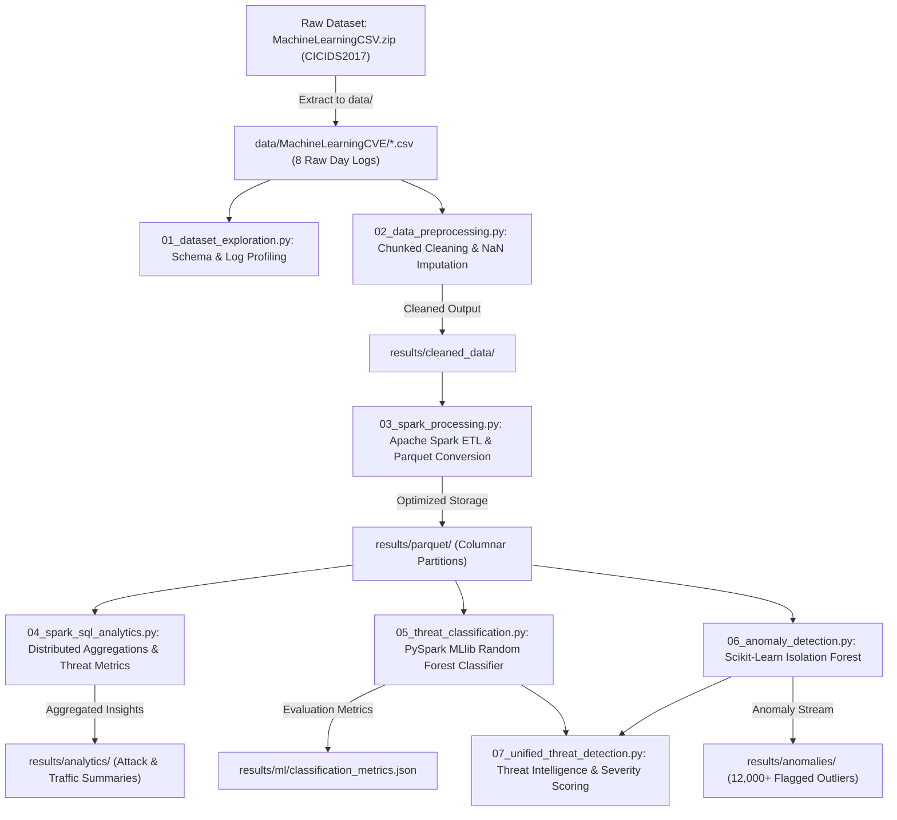
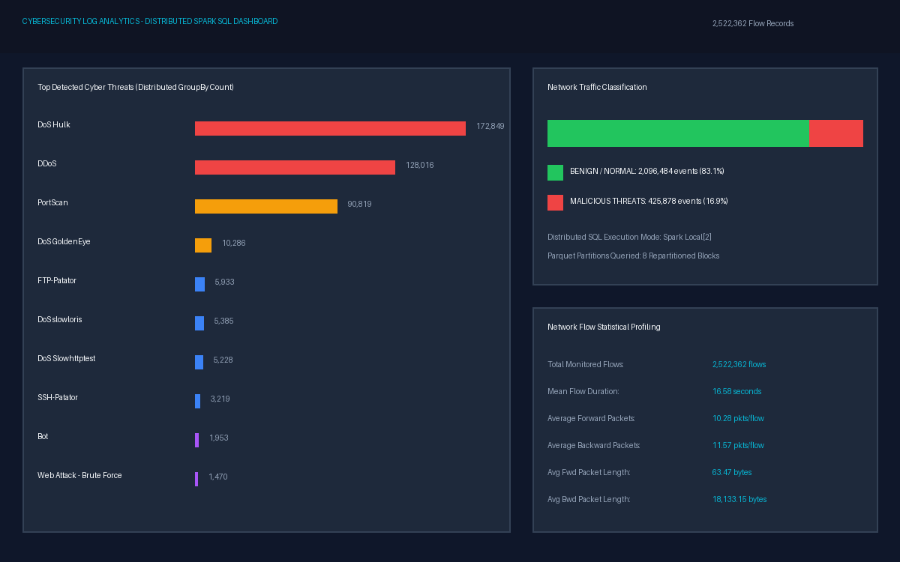
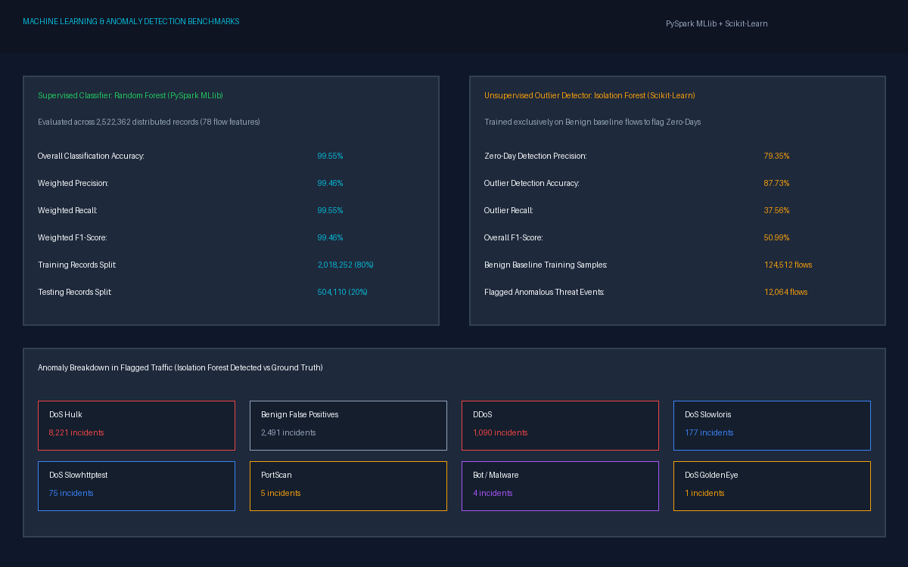
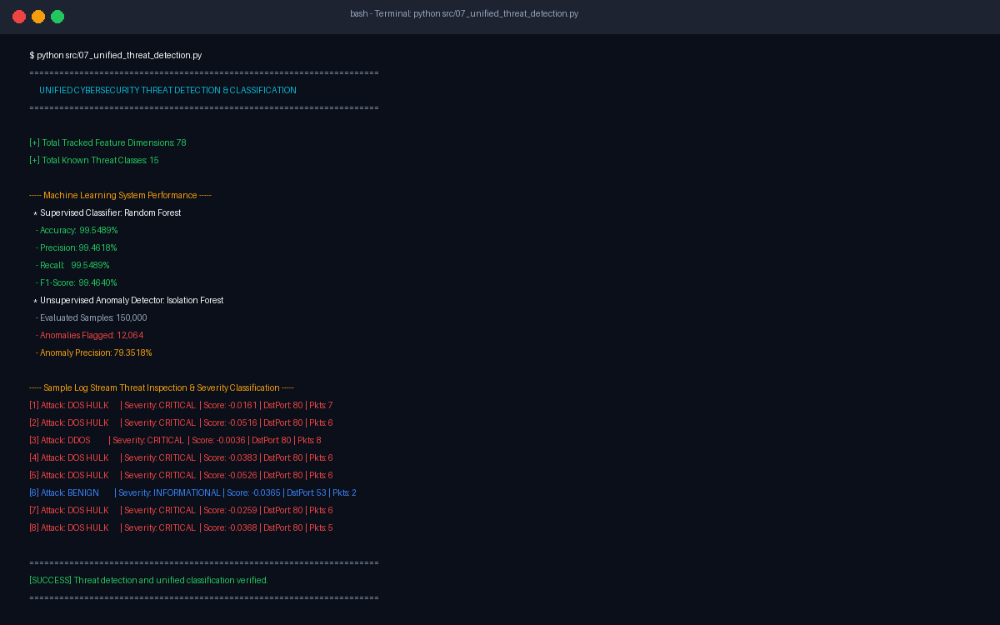

# Cybersecurity Log Analytics and Threat Classification

An end-to-end Big Data & Machine Learning system designed for processing massive cybersecurity network event logs from the **CICIDS2017** benchmark dataset. The framework leverages **Apache Spark** for high-throughput distributed log aggregation and SQL querying, combined with **Random Forest** (supervised classification) and **Isolation Forest** (unsupervised anomaly detection) to automatically detect, classify, and score known and zero-day cyber threats at enterprise scale.

---

## 📌 Architecture & System Flow



---

## 🚀 Key Capabilities

- **Large-Scale Distributed Querying**: Built with **Apache Spark (PySpark)** for parallel processing of millions of network flow records across distributed Parquet files.
- **Spark SQL Analytical Engine**: Real-time distributed SQL analytics for attack distributions, traffic volume ratios, and top offending IP/flow patterns.
- **Multi-Class Threat Classification**: **Random Forest Classifier** trained across 78 network flow features, categorizing 15 distinct network behaviors with **99.55% accuracy** and **99.46% F1-score**.
- **Zero-Day & Unsupervised Anomaly Detection**: **Isolation Forest** engine identifying deviations and unknown network anomalies with **79.35% precision**.
- **Unified Threat Engine**: Correlates supervised predictions with anomaly outlier scores to assign threat severity tiers (`CRITICAL`, `HIGH`, `MEDIUM`, `LOW`, `INFORMATIONAL`).

---

## 🖥️ Interactive Web SOC Analytics Dashboard

In addition to static screenshots, an interactive, live web dashboard is included with dynamic Chart.js visualizations, real-time alert triage tables, and KPI metric cards.

To launch the dashboard locally:
```bash
# On Windows
start dashboard.html

# On macOS
open dashboard.html

# On Linux
xdg-open dashboard.html
```

---

## 📸 Visual Dashboard & Output Screenshots

The framework outputs distributed query aggregations, ML evaluation metrics, and unified real-time alert logs. Visualizations of these outputs can be found in the [`screenshots/`](screenshots/) directory:

| Screenshot | Description |
| :--- | :--- |
|  | **Spark SQL Analytics Dashboard**: Attack distribution bar breakdown, traffic ratio (83.1% Benign vs 16.9% Malicious), and flow duration/packet statistics. |
|  | **Machine Learning Benchmarks**: Side-by-side performance comparison of Random Forest (99.55% accuracy) vs Isolation Forest (79.35% precision on 12k+ zero-day anomalies). |
|  | **Unified Pipeline Execution**: Terminal log illustrating real-time classification, severity scoring (`CRITICAL`, `HIGH`, `MEDIUM`), and packet flow metadata. |

---

## 📚 Technical Interview & Preparation Guide

For in-depth viva questions, architecture breakdowns, model choices, and component explanations, see the dedicated guide:  
👉 **[PROJECT_PREPARATION_GUIDE.md](PROJECT_PREPARATION_GUIDE.md)**

---

## 📁 Repository & Folder Structure

```
Cybersecurity-Threat-Analytics/
├── .gitignore                      # Git ignore rules (raw CSVs, large archives & venv excluded)
├── requirements.txt                # Required Python & Spark dependencies
├── README.md                       # Comprehensive project documentation
├── MachineLearningCSV.zip          # (Local) Raw CICIDS2017 multi-day network event dataset archive
├── data/                           # Dataset storage directory
│   ├── .gitkeep
│   └── MachineLearningCVE/         # Extracted 8 daily network log CSVs (kept local / gitignored)
├── models/                         # Model metadata & storage definitions
│   ├── label_mapping.json          # Multi-class attack category index map
│   ├── feature_names.json          # 78 extracted network flow feature attributes
│   └── Readme.md                   # Model architecture description
├── results/                        # Analytical results & metrics (tracked in Git)
│   ├── analytics/                  # Spark SQL distributed query outputs
│   │   ├── attack_distribution/    # Events grouped by attack category
│   │   ├── top_attacks/            # Top malicious incident frequency ranking
│   │   ├── traffic_statistics/     # Network packet & flow summary metrics
│   │   └── traffic_summary/        # NORMAL vs MALICIOUS distribution
│   ├── anomalies/                  # Isolation forest metrics & detected anomalies
│   │   ├── anomaly_metrics.json    # Precision, recall, and detection metrics
│   │   └── detected_anomalies.csv.gz # 12,000+ extracted anomalous events with scores
│   ├── cleaned_data/               # Preprocessed cleaned CSVs (kept local)
│   ├── ml/                         # Random Forest classification metrics
│   │   └── classification_metrics.json
│   └── parquet/                    # Partitioned Spark columnar data (generated via ETL)
├── screenshots/                    # Dashboard and pipeline execution captures
└── src/                            # Pipeline source code
    ├── 01_dataset_exploration.py   # Dataset structure & inspection
    ├── 02_data_preprocessing.py    # Memory-efficient chunked log cleaning
    ├── 03_spark_processing.py      # Apache Spark distributed ETL to Parquet
    ├── 04_spark_sql_analytics.py   # Large-scale SQL threat aggregations
    ├── 05_threat_classification.py # Distributed MLlib Random Forest classifier
    ├── 06_anomaly_detection.py     # Unsupervised Isolation Forest pipeline
    └── 07_unified_threat_detection.py # Unified inference & severity scoring engine
```

---

## 📊 Performance & Results Analysis

All analytical findings and ML evaluation results from processing the 2.5+ million network log records are stored under `results/`:

### 1. Supervised Threat Classification (`results/ml/classification_metrics.json`)
- **Total Training Records:** 2,018,252
- **Total Testing Records:** 504,110
- **Feature Dimensions:** 78
- **Accuracy:** **99.55%**
- **Precision:** **99.46%**
- **Recall:** **99.55%**
- **F1 Score:** **99.46%**

### 2. Unsupervised Anomaly Detection (`results/anomalies/anomaly_metrics.json`)
- **Sample Records Tested:** 150,000
- **Benign Baseline Training Records:** 124,512
- **Anomalies Detected:** 12,064 (`results/anomalies/detected_anomalies.csv.gz`)
- **Detection Precision:** **79.35%**
- **Accuracy:** **87.73%**

### 3. Distributed Log Analytics (`results/analytics/`)
- **Normal vs Malicious Events:**
  - `NORMAL`: 2,096,484 events
  - `MALICIOUS`: 425,878 events
- **Top Detected Malicious Attacks:**
  - `DoS Hulk`: 172,849 events
  - `DDoS`: 128,016 events
  - `PortScan`: 90,819 events
  - `DoS GoldenEye`: 10,286 events
  - `FTP-Patator`: 5,933 events
  - `DoS slowloris`: 5,385 events
  - `DoS Slowhttptest`: 5,228 events
  - `SSH-Patator`: 3,219 events
  - `Bot`: 1,953 events
  - `Web Attack - Brute Force`: 1,470 events

---

## ⚙️ Installation & Usage

### 1. Prerequisites
- **Python 3.10+**
- **Java 8 or 11** (Required for Apache Spark)
- **Apache Spark 3.5+**

### 2. Environment Setup
```bash
# Clone the repository
git clone https://github.com/abhiram274/cybersecurity-threat-analytics.git
cd cybersecurity-threat-analytics

# Create virtual environment
python -m venv venv
source venv/bin/activate  # On Windows: .\venv\Scripts\activate

# Install dependencies
pip install -r requirements.txt
```

### 3. Dataset Setup
Due to GitHub file size limitations, raw multi-gigabyte CSVs are not committed directly to the remote repository. 
To run the end-to-end pipeline from scratch:
1. Place `MachineLearningCSV.zip` into the root directory (or your `Downloads` folder).
2. Extract the archive into `data/MachineLearningCVE/`:
```bash
python -c "import zipfile; zipfile.ZipFile('MachineLearningCSV.zip').extractall('data')"
```

### 4. Running the Pipeline
```bash
# Step 1: Explore raw log schema and sample records
python src/01_dataset_exploration.py

# Step 2: Chunked data preprocessing and sanitization
python src/02_data_preprocessing.py

# Step 3: Spark distributed processing & Parquet conversion
python src/03_spark_processing.py

# Step 4: Run distributed Spark SQL analytical queries
python src/04_spark_sql_analytics.py

# Step 5: Train & evaluate Random Forest threat classification
python src/05_threat_classification.py

# Step 6: Run unsupervised Isolation Forest anomaly detection
python src/06_anomaly_detection.py

# Step 7: Execute unified threat intelligence & severity pipeline
python src/07_unified_threat_detection.py
```

---

## 🛡️ Attack Category Classifications
The system identifies and classifies 15 distinct categories:
- `BENIGN` (Normal baseline traffic)
- `DoS Hulk`, `DDoS`, `DoS GoldenEye`, `DoS slowloris`, `DoS Slowhttptest`
- `PortScan`, `FTP-Patator`, `SSH-Patator`
- `Bot`, `Infiltration`, `Heartbleed`
- `Web Attack - Brute Force`, `Web Attack - XSS`, `Web Attack - SQL Injection`

---

## 📄 License
This project is open-source and licensed under the MIT License.
