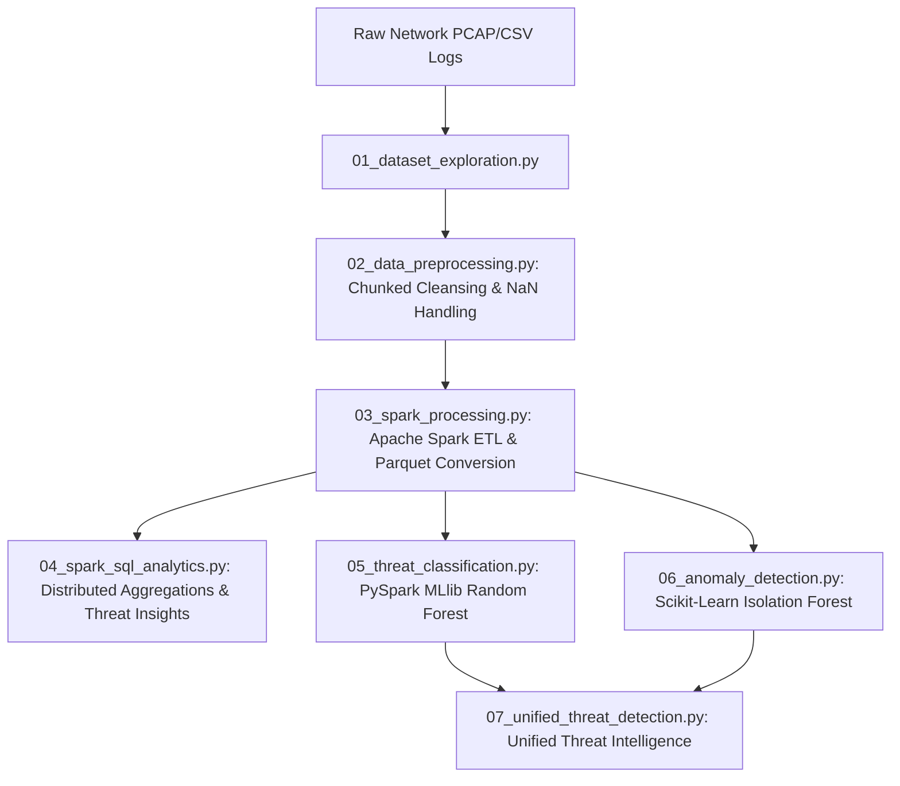

# Cybersecurity Log Analytics and Threat Classification

An end-to-end Big Data & Machine Learning system designed for processing massive cybersecurity network event logs (e.g., CICIDS2017). This framework integrates **Apache Spark** for high-throughput distributed log aggregation and SQL querying, combined with **Random Forest** (supervised classification) and **Isolation Forest** (unsupervised anomaly detection) to automatically detect and classify zero-day and known cyber threats at enterprise scale.

---

## 📌 Architecture & System Overview



---

## 🚀 Key Features

- **Large-Scale Distributed Querying**: Built with **Apache Spark (PySpark)** for parallel processing of millions of network flow records across distributed Parquet files.
- **Spark SQL Analytical Engine**: Real-time distributed SQL analytics for attack distributions, traffic volume ratios, and top offending IP/flow patterns.
- **Multi-Class Threat Classification**: **Random Forest Classifier** trained across 78 network flow features, categorizing 15 distinct network behaviors with **99.55% accuracy** and **99.46% F1-score**.
- **Zero-Day & Unsupervised Anomaly Detection**: **Isolation Forest** engine identifying deviations and unknown network anomalies with **79.35% precision**.
- **Unified Threat Engine**: Correlates supervised predictions with anomaly outlier scores to assign threat severity tiers (`CRITICAL`, `HIGH`, `MEDIUM`, `LOW`, `INFORMATIONAL`).

---

## 📊 Performance & Evaluation Summary

### 1. Supervised Threat Classification (Random Forest)
- **Training Records:** 2,018,252
- **Testing Records:** 504,110
- **Features Used:** 78
- **Accuracy:** **99.55%**
- **Precision:** **99.46%**
- **Recall:** **99.55%**
- **F1 Score:** **99.46%**

### 2. Unsupervised Anomaly Detection (Isolation Forest)
- **Evaluated Samples:** 150,000
- **Benign Baseline Training:** 124,512
- **Anomalies Detected:** 12,064
- **Precision:** **79.35%**
- **Accuracy:** **87.73%**

---

## 📁 Repository Structure

```
Cybersecurity-Threat-Analytics/
├── .gitignore                      # Git ignore file for datasets, models & venvs
├── requirements.txt                # Required Python & Spark dependencies
├── README.md                       # Comprehensive project documentation
├── models/                         # Model metadata & storage definitions
│   ├── label_mapping.json          # Multi-class attack category index map
│   ├── feature_names.json          # 78 extracted network flow feature attributes
│   └── Readme.md                   # Model architecture description
├── results/                        # Analytical results & metrics
│   ├── analytics/                  # Spark SQL distributed query outputs
│   ├── anomalies/                  # Isolation forest metrics & detected anomalies
│   └── ml/                         # Random Forest classification metrics
├── screenshots/                    # Dashboard and pipeline execution captures
└── src/                            # Pipeline source code
    ├── 01_dataset_exploration.py   # Dataset structure & inspection
    ├── 02_data_preprocessing.py    # Memory-efficient chunked log cleaning
    ├── 03_spark_processing.py      # Apache Spark distributed ETL to Parquet
    ├── 04_spark_sql_analytics.py   # Large-scale SQL threat aggregations
    ├── 05_threat_classification.py # Distributed MLlib Random Forest classifier
    ├── 06_anomaly_detection.py     # Unsupervised Isolation Forest pipeline
    └── 07_unified_threat_detection.py # Unified inference & severity scoring engine
```

---

## ⚙️ Installation & Usage

### 1. Prerequisites
- **Python 3.10+**
- **Java 8 or 11** (Required for Apache Spark)
- **Apache Spark 3.5+**

### 2. Setup Environment
```bash
# Clone the repository
git clone https://github.com/abhiram274/cybersecurity-threat-analytics.git
cd cybersecurity-threat-analytics

# Create virtual environment
python -m venv venv
source venv/bin/activate  # On Windows: .\venv\Scripts\activate

# Install dependencies
pip install -r requirements.txt
```

### 3. Run Pipeline Stages
```bash
# Step 1: Preprocess raw network logs
python src/02_data_preprocessing.py

# Step 2: Spark distributed processing & Parquet conversion
python src/03_spark_processing.py

# Step 3: Run distributed Spark SQL analytical queries
python src/04_spark_sql_analytics.py

# Step 4: Train & evaluate Random Forest threat classification
python src/05_threat_classification.py

# Step 5: Run unsupervised Isolation Forest anomaly detection
python src/06_anomaly_detection.py

# Step 6: Execute the unified threat intelligence & severity pipeline
python src/07_unified_threat_detection.py
```

---

## 🛡️ Detected Attack Categories
The pipeline identifies and categorizes 15 classes of network behavior:
- `BENIGN` (Normal baseline traffic)
- `DoS Hulk`, `DDoS`, `DoS GoldenEye`, `DoS slowloris`, `DoS Slowhttptest`
- `PortScan`, `FTP-Patator`, `SSH-Patator`
- `Bot`, `Infiltration`, `Heartbleed`
- `Web Attack - Brute Force`, `Web Attack - XSS`, `Web Attack - SQL Injection`

---

## 📄 License
This project is open-source and licensed under the MIT License.
